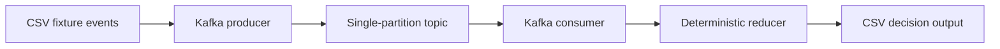

# Service Error Radar

An on-call team needs one actionable alert for an error burst without a new page for every subsequent log entry. This is a reproducible, synthetic-data Java 21 + Apache Kafka 4.3.1 portfolio project.



The offline path feeds the same reducer directly and needs no broker. The live path creates a uniquely named one-partition topic, publishes each fixture record, consumes those records, and prints the decision output. A unique topic prevents prior runs from contaminating a demonstration.

## Data contract

Input: `event_id,service,minute,severity` where severity is `INFO` or `ERROR`.

Output: `service,minute,error_count`. See [the checked-in example](examples/result.csv).

- Track errors per service over the current minute and previous four minutes.
- Alert at three errors; suppress further alerts for the same service for ten minutes.
- Ignore exact duplicate IDs; reject invalid severities and out-of-order service events.

## Run

Install a Java 21 JDK and [Apache Kafka 4.3.1](https://kafka.apache.org/downloads/), then set `JAVA_HOME` to the JDK directory and `KAFKA_HOME` to the Kafka distribution directory containing `libs/`. From this repository's root in PowerShell:

```powershell
.\build.ps1
.\build.ps1 -Demo
```

The first command compiles the Java source and runs the deterministic behavior tests. The second also prints the fixture result. Build classes remain under ignored `build/`. To exercise a running local broker:

```powershell
.\build.ps1 -Broker 'localhost:9092'
```

The Kafka path is a bounded demo, not a long-running production service. It assumes ordered per-key events in one partition, uses synthetic data, and has no authentication or retention policy. Adapt those choices before connecting real data.
